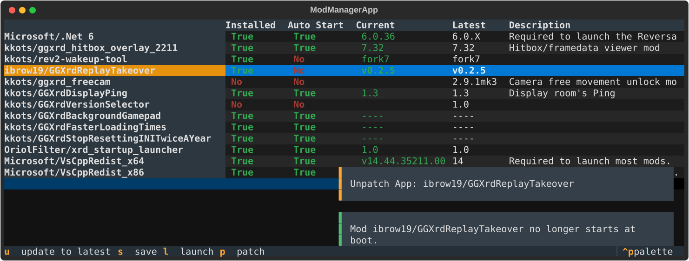

# What this

This is a mod (more like tools) managed for Xrd.

Main features are:

- Downloading/Updating
- Launching
- Running them when Xrd starts. (useful for example with the hitbox viewer or the replay takeover mod)



## I have Linux, does it work there?

Yes.

## Currently configured mods/tools.

| Name                                                                                               | Notes                                                                             |
|----------------------------------------------------------------------------------------------------|-----------------------------------------------------------------------------------|
| [kkots/rev2-wakeup-tool](https://github.com/kkots/rev2-wakeup-tool/)                               | Core tool for training mode allowing to make the doomy take actions.              |
| [ibrow19/GGXrdReplayTakeover](https://github.com/ibrow19/GGXrdReplayTakeover/)                     | Take control feature for Xrd replays system.                                      |
| [kkots/ggxrd_hitbox_overlay_2211](https://github.com/kkots/ggxrd_hitbox_overlay_2211/)             | Hitbox/framedata viewer mod.                                                      |
| [kkots/ggxrd_freecam](https://github.com/kkots/ggxrd_freecam/)                                     | Camera free movement unlock mod.                                                  |
| [kkots/GGXrdVersionSelector](https://github.com/kkots/GGXrdVersionSelector/)                       | You can select the Xrd patch version. This includes balance changes.              |
| [kkots/GGXrdDisplayPing](https://github.com/kkots/GGXrdDisplayPing/)                               | Display room's Ping.                                                              |
| [OriolFilter/xrd_startup_launcher](https://github.com/OriolFilter/xrd_startup_launcher/)           | Some mods need it to be started when Xrd opens.                                   |
| [kkots/GGXrdBackgroundGamepad](https://github.com/kkots/GGXrdBackgroundGamepad/)                   | Allows the controller's focus not be lost if the active windows is no longer Xrd. |
| [kkots/GGXrdFasterLoadingTimes](https://github.com/kkots/GGXrdBackgroundGamepad/)                  | Reduce time when booting Xrd and getting faster into matches.                     |
| [kkots/GGXrdStopResettingINITwiceAYear](https://github.com/kkots/GGXrdStopResettingINITwiceAYear/) | Avoid having the .ini file restored when daylight savings apply.                  |

### Others/Misc

| Name              | Notes                                                            |
|-------------------|------------------------------------------------------------------|
| .Net (DotNet) 6   | The Reversal/Wakeup tool requires this to work.                  |
| VsRedistributable | Windows only. Various mods require this in order to be launched. |


### Future/What about X other mod/tool

| Name                                                                                                       | Notes                                                                     |
|------------------------------------------------------------------------------------------------------------|---------------------------------------------------------------------------|
| [kkots/GGXrdMirrorColorSelect](https://github.com/kkots/GGXrdMirrorColorSelect/)                           | It makes use of a closer source executable, thus it's excluded from here. |
| [kkots/GGXrdChangeBorderlessWindowPos](https://github.com/kkots/GGXrdChangeBorderlessWindowPos/)           | TODO                                                                      |
| [kkots/GGXrdAutomaticallyChangeAudioDevice](https://github.com/kkots/GGXrdAutomaticallyChangeAudioDevice/) | TODO (the intend is to outsource Kkots)                                   |
| PC Volt thing                                                                                              | TODO                                                                      |

## How can I run it?

Check [here](https://github.com/OriolFilter/xrd_tool_downloader/releases/latest) for the latest update.

At the bottom (assets section), it will have 2 files attached:

- `main.exe`
- `main_linux`

### Windows

Download `main.exe`.

### Linux

> This assumes you are familiar with the Linux terminal.

Download `main_linux`.

Set execution permissions
```shell
chmod +x main_linux
```

```shell
./main_linux
```

Create a .desktop entry in the user applications directory.

```shell
# ~/.local/share/applications/xrd_tool_downloader.desktop
[Desktop Entry]
Name=Xrd Tool Downloader
Comment=Xrd Tool Downloader
Exec=/home/goblin/PycharmProjects/xrd_mod_downloader_2/binary_dump/main_linux
Terminal=true
Type=Application
Categories=Game;
```

#### What if I want to launch it through the terminal

Just launch the binary then, it's my preferred method.

```shell
./main_linux
```

## I want to either build it myself, or run the code directly.

> Using virtual environments is a **good and recommended** practice, but I won't go over that.
 
> This assumes you have both, Python installed and the `pip` command.
> 
> - [How to install Python3](https://www.python.org/downloads/)
> - [How to install PIP](https://pip.pypa.io/en/stable/installation/)

### Installing the libraries/dependencies

```shell
pip3 install -r requirements.txt
```

### Launching the code

The file `config.json` will be located where the file gets executed on, therefore it's recommended to not launch it from the same folder where the code is located.

```shell
python3 src/main.py
```

### Building

Locate yourself within the 

#### Linux

```shell
pyinstaller src/main.py  --clean -F --hidden-import "textual.widgets._tab_pane" --hidden-import "rich._unicode_data.unicode17-0-0"
```

#### Windows

```shell
pyinstaller src/main.py  --clean -F --hidden-import "textual.widgets._tab_pane" --hidden-import "rich._unicode_data.unicode17-0-0"  --nowindow
```

# Tested on

- 64 bit Endevour OS (Arch)
- 64 bit Windows 10